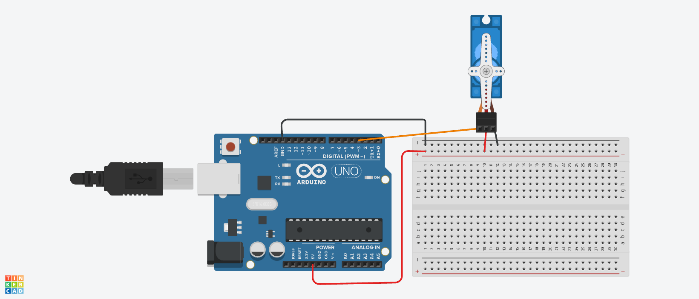

# Lab: Servo Motor
In this lab, you will connect a servo motor to your Arduino and write functions that control its position.

## 1. Understand the servo motor
A servo motor is an actuator that rotates to a specific position. An actuator is a device that converts energy (electricity, compressed air, or pressurized liquid) into physical motion to move or operate something, Unlike a regular DC motor that spins continuously, a standard positional servo can move to and hold a particular angle, typically something between 0° and 180°.

Servo motors are used in robotics, automated doors, camera mounts, and other interactive systems.


## 2. Connect the servo
A servo motor most often has three wires. Connect your servo using the table below.

| Wire Color | Arduino Pin |
| ---        | ---         |
| Brown      | GND (-)     |
| Red        | 5V (+)      |
| Orange     | Digital Pin 3 |

**Important:** Never force your servo to rotate manually.  You can damage the little gear-dos on the inside.

Use the wiring diagram below as a guide.



# 3. Move the server to a specific angle
1. Examine the code in `servo.ino`. 
2. Send it to the Arduino and observe what it does.

## Reflect
1. What does `servo.attach(servoPin);` do?
    > your answer

2. What does `servo.write(90);` do?
    > your answer

3. Why do we need to call `delay()` between movements?
    > your answer

4. What happens when you change one of the calls to 45˚?
    > your answer


# 4. Create a movement function
1. Add the following code underneath `loop()` to create a movement function. This will eliminate repeating the `delay()` calls.

```c++
 /**
  * @brief Moves the servo to a specified angle.
  *
  * @param angle The position to move to in degrees
  */
void moveServo(int angle) {
    servo.write(angle);
    delay(1000);
}
```
2. **Refactor** your `loop()` so it uses calls to `moveServo()`. You should only have three lines of code, but **the servo behavior should stay the same**.

# 5. Sweep the servo
The previous program can be bit jumpy. Replace your `loop()` function with this code to use a for loop to move from the beginning to end angle more gradually.

```c++
void loop() {
    int start = 0;
    int end = 180;
    
    // go from start to end
    for (int angle = start; angle <= end; angle++) {
        servo.write(angle);
        delay(15);
    }

    delay(500);

    // reverse
    for (int angle = end; angle > start; angle--) {
        servo.write(angle);
        delay(15);
    }
    
    delay(500);
}

```
## For loops
A `for` loop repeats a block of code a specific number of times. In C/C++ (and many other languages), it has three parts:
1. Initialization: Sets the starting value of a counter variable.
2. Ending Condition: Determines whether the loop should continue.
3. Update: Changes the counter variable after each repetition.
For example, this loop gradually moves the servo from 0° to 180°:
```c++
    for (int angle = start; angle <= end; angle++) {
        servo.write(angle);
        delay(15);
    }
```

- `int angle = start` starts the counter variable `angle` at 0.
- `angle <= end` keeps the loop running while the angle is 180 or less.
- `angle++` increases the angle by 1 after each repetition.
- `servo.write(angle)` moves the servo toward the current angle.
- `delay(15)` pauses for 15 milliseconds between updates.

## Reflect
1. Why does the servo move more smoothly than in Part 3?
    > your answer

2. What happens if you change `delay(15)` to `delay(50)`?
    > your answer

3. What code controls the direction of the servo's movement?
    > your answer

4. What happens if you change the end angle from 180 to 90?
    > your answer

# 5. Create a function called `sweepServo()`

Create a function called `sweepServo()` that accepts three parameters. Make sure to complete the function documentation in the comment above it.

```c++
 /**
  * @brief Describe me
  * 
  * @param startAngle explain what the parameter is
  * @param endAngle explain what the parameter is
  * @param speed explain what the parameter is
  */
void sweepServo(int startAngle, int endAngle, int speed) {
  // TODO: Complete me
}
```

The functon should 
- Move the servo from `startAngle` to `endAngle`.
- Work in either direction.
- Use speed to control the delay between movements.
- Use a loop instead of writing every angle.

## Test the function
Test your function with the following calls.
```c++
sweepServo(0, 90, 20);
sweepServo(90, 180, 10);
sweepServo(180, 0, 15);
```

# 6. Wrap-up
1. Why would you want to control the speed of a servo's movement?
    > your answer

2. Describe an interactive system that could use a servo motor.
    > your answer

3. How could you combine a servo motor with a temperature sensor, push button, or potentiometer?
    > your answer

