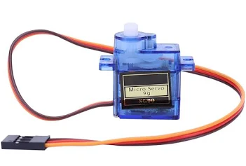

# Lab: Servo Motor
In this lab, you will connect a servo motor to your Arduino and write functions that control its position.

## 1. Understand the servo motor
A servo motor is an actuator that rotates to a specific position. An actuator is a device that converts energy (electricity, compressed air, or pressurized liquid) into physical motion to move or operate something, Unlike a regular DC motor that spins continuously, a standard positional servo can move to and hold a particular angle, typically something between 0° and 180°.

Servo motors are used in robotics, automated doors, camera mounts, and other interactive systems.

## 2. Connect the servo
A servo motor most often has three wires. Connect your servo using the table below.

| Wire Color | Arduino Pin |
| ---        | ---         |
| Brown      | GND (-)     |
| Red        | 5V (+)      |
| Orange     | Digital Pin 3 |

**Important:** Never force your servo to rotate manually.  You can damage the little gear-dos on the inside.

Use the wiring diagram below as a guide.

